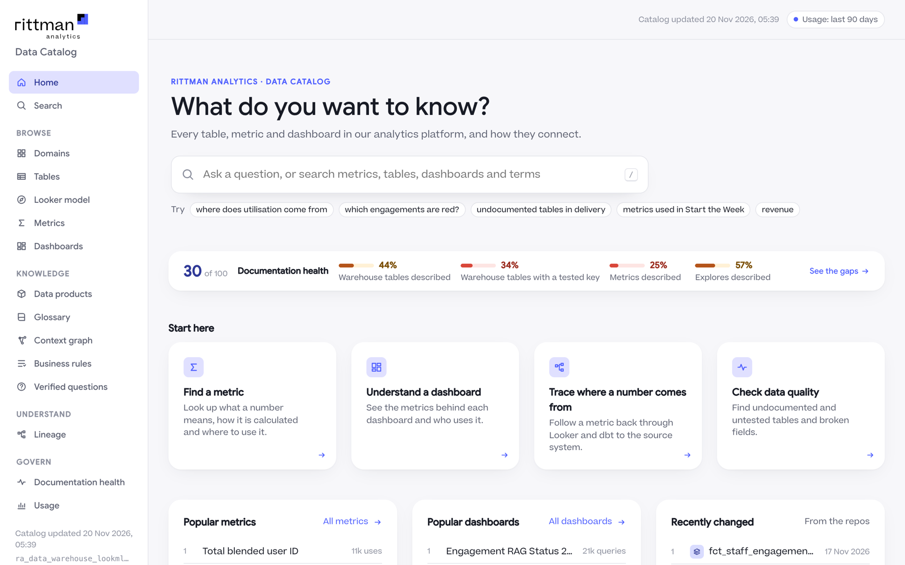
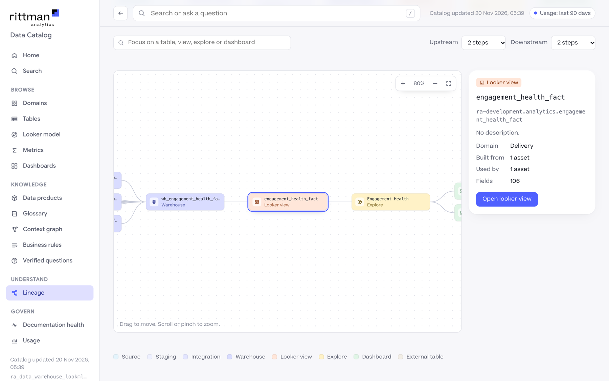
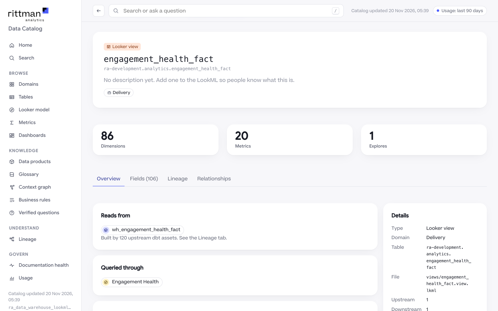
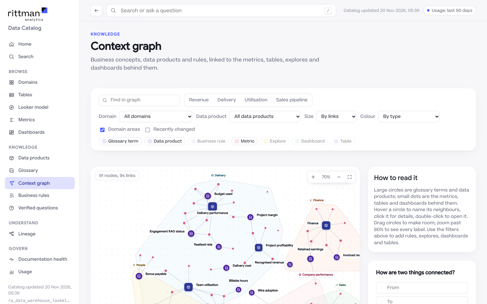
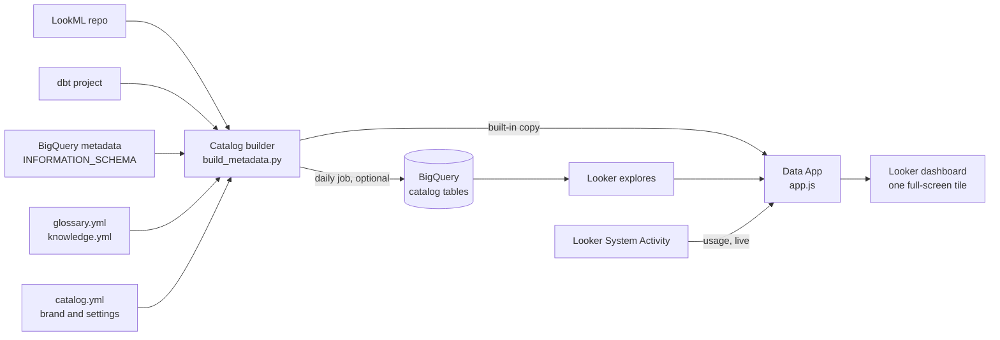

# Looker Data Catalog

A data catalog and knowledge catalog that runs inside Looker, as a [Looker Data App](https://docs.cloud.google.com/looker/docs/data-apps). It is built from your LookML, your dbt project and your BigQuery metadata, and branded with your own logo, colours and fonts.

This repo is a [Claude](https://claude.com) skill: Claude follows it to set up, brand, build, check and publish the catalog for you. You can also follow the same steps by hand.

Made by [Rittman Analytics](https://rittmananalytics.com) with [Wire](https://github.com/rittmananalytics/wire-plugin), our framework for building data platforms with Claude. MIT licence.



## What people can do with it

| Page | What it shows |
|---|---|
| Search | Metrics, tables, columns, explores, dashboards and glossary terms, with suggested questions in your own words |
| Domains | Your business areas and the tables, metrics and dashboards in each |
| Tables and Looker model | Every dbt model and Looker view, with columns, types, descriptions, dbt tests, joins and where each one is used |
| Metrics | Every Looker measure, its SQL, the explores and dashboards that use it, and the glossary terms it calculates |
| Dashboards | LookML and Looker dashboards and the fields behind each tile |
| Lineage | How data moves from source systems through dbt into Looker, for any asset, upstream and downstream |
| Data products, Glossary, Business rules, Verified questions | Knowledge you write with the people who own the numbers. Each item shows its owner and whether it is confirmed |
| Context graph | Glossary terms, data products and rules, linked to the metrics, tables and dashboards behind them |
| Documentation health | How much is described and tested, by model, explore, view, dbt layer, domain and data product, and the gaps to fix first |
| Usage | The most used explores, fields and dashboards in the last 90 days, from Looker System Activity |

| Lineage | Table page | Context graph |
|---|---|---|
|  |  |  |

## How it works



1. A build script reads the LookML repo, the dbt project (with `dbt parse`, no warehouse login) and BigQuery's table metadata. It reads no table data.
2. It adds the glossary, business rules, data products and verified questions you write in YAML.
3. It packs the result into the app, and can also load it into BigQuery each day. With the daily load, the app reads the latest build through Looker and does not need republishing when your model changes.
4. Usage figures come live from Looker System Activity when someone opens the app.

The app runs as the person viewing it, so Looker's own permissions apply.

## Keeping it up to date

Once the live refresh is set up, the catalog updates itself. A GitHub Actions job in the LookML repo rebuilds the catalog and loads it into BigQuery. Looker clears its cache when a new build lands, and the app loads the newest build when someone opens it. The app shows "Catalog updated <time>". If it cannot reach BigQuery, it falls back to the copy built into it and shows "Built-in copy from <date>".

**When the job runs**

| Trigger | Picks up |
|---|---|
| Every day at 05:30 UTC | Everything, including dbt changes and warehouse column, size and freshness changes |
| A merge to the production branch that touches `views/`, `models/`, `dashboards/`, `explores/` or `data_apps/` | LookML changes, and glossary or knowledge edits, within minutes |
| Run by hand from the Actions tab | Anything, on demand |

Usage figures do not need the job: the app reads them live from Looker System Activity. Changes to the app's own code or design still need a republish.

**How to turn it on**

`new_client.py` creates every file these steps need. Full detail is in [rollout.md](skills/looker-data-catalog/reference/rollout.md).

1. **BigQuery:** run `bigquery_tables.sh` once to create the catalog dataset and 6 empty tables.
2. **Access:** create a service account with read-only metadata access on the warehouse project and write access to the catalog dataset only.
3. **GitHub:** set up workload identity federation for the LookML repo, so the job signs in without a key file. Add a read-only deploy key for the dbt repo as the secret `DBT_REPO_DEPLOY_KEY`.
4. **LookML:** add the catalog views, the explore file, the builder and the workflow file to the LookML repo, and one line to the model: `include: "/data_apps/*.explore.lkml"`.
5. **Deploy:** validate in Looker, merge, deploy to production, then run the job once by hand and check that the app shows "Catalog updated".

Without these steps the catalog still works, from the copy built into the app. Each update then needs a rebuild and a republish.

## What you need

- A Looker-hosted instance, version 26.18 or later, with Data Apps switched on under Admin, General, Previews.
- Google's Looker Data Apps toolkit, for previewing and publishing: `bash <(curl -fsSL https://dl.google.com/looker-data-apps/install.sh)`.
- The [Wire](https://github.com/rittmananalytics/wire-plugin) plugin for Claude Code. It adds the Data Apps rules and checks, and a publish command that shows a dry run and asks before it publishes. Install it with:

  ```
  /plugin marketplace add rittmananalytics/wire-plugin
  /plugin install wire@rittman-analytics
  /reload-plugins
  ```
- Your LookML repo and dbt project, cloned on your machine.
- Python 3.10 or later, and [uv](https://docs.astral.sh/uv/) or pip.
- BigQuery, for warehouse columns, sizes and freshness and for the daily refresh. Without BigQuery the catalog still works from dbt and LookML alone.

## Install

### Claude Code

```
/plugin marketplace add rittmananalytics/Looker-data-catalog
/plugin install looker-data-catalog@looker-data-catalog
```

Then ask, for example: *"Build a data catalog for Acme Retail. The LookML repo is in ~/repos/acme_lookml and the dbt project is in ~/repos/acme_dbt."*

### Claude.ai or Claude Desktop

Download `looker-data-catalog.zip` from the [latest release](https://github.com/rittmananalytics/Looker-data-catalog/releases/latest) and upload it as a custom skill in Claude's settings. The build and publish steps run scripts on your machine, so Claude Code is the better fit for those.

### By hand

Clone this repo and follow [skills/looker-data-catalog/SKILL.md](skills/looker-data-catalog/SKILL.md) from Step 1. Every step is a command you can run yourself.

## The steps

| Step | What happens |
|---|---|
| 1. Set up | `new_client.py` creates a project folder with the app, the builder and a filled-in `catalog.yml` |
| 2. Brand | Add your logo and colours; `check_brand.py` checks contrast, logo safety, font size and privacy settings |
| 3. Map the model | Map dbt folders to layers and domains |
| 4. Knowledge | Draft glossary terms, rules, data products and questions, check them against the code, and confirm them with named owners |
| 5. Build | `build_metadata.py` builds the app (kept under Looker's 900 KB limit per app) |
| 6. Check and preview | Google's `verify-app.py` and local preview |
| 7. Live refresh | Optional: BigQuery tables, LookML explores and a daily GitHub Actions job |
| 8. Publish | Google's publisher creates a Looker dashboard with the app as one full-screen tile |

Details for each step: [SKILL.md](skills/looker-data-catalog/SKILL.md), [branding](skills/looker-data-catalog/reference/branding.md), [knowledge content](skills/looker-data-catalog/reference/knowledge.md) and [live refresh](skills/looker-data-catalog/reference/rollout.md).

## Repo layout

```
.claude-plugin/                 plugin and marketplace manifests for Claude Code
skills/looker-data-catalog/
  SKILL.md                      the full guide Claude follows
  reference/                    branding, knowledge content, live refresh
  scripts/                      new_client.py, check_brand.py
  template/
    app/src/app.src.js          the Data App source, shared by every deployment
    catalog_builder/            build_metadata.py, pinned requirements, catalog.yml template
    lookml/                     views and explores for the live refresh
    ci/                         daily GitHub Actions job
    bigquery_tables.sh          creates the catalog dataset and tables
docs/images/                    screenshots
```

## Privacy and security

- The catalog holds metadata only: names, types, descriptions, SQL definitions, lineage and row counts. It holds no table data.
- People's names are hidden on the Usage page by default (`usage.show_people: false`).
- Your Looker credentials stay in the toolkit's `data-apps-config.json` on your machine. Nothing in this repo reads or stores them.
- The daily job uses a service account with read-only metadata access to the warehouse and write access to the catalog dataset only, through workload identity federation (no key files).

## Limits

- Looker Data Apps are a Google preview feature. Viewers need access to www.gstatic.com.
- Warehouse metadata and the daily refresh support BigQuery only.
- No PDF export or scheduled delivery of the app.
- Copies of the published dashboard share one app, so a republish changes every copy.
- Very large projects need the size settings described in Step 5 to stay under 900 KB.

## Built with Wire

The catalog was built with [Wire](https://github.com/rittmananalytics/wire-plugin), Rittman Analytics' framework for building data platforms with Claude Code. Wire's Data Apps skill and commands wrote and checked the app against the tile sandbox rules, ran Google's verify stages against Looker, and published it to Looker after a dry run and a confirmation.

## Contributing

Issues and pull requests are welcome. See [CONTRIBUTING.md](CONTRIBUTING.md).

## Licence

[MIT](LICENSE). Copyright 2026 Rittman Analytics.
